<h1><a href="https://github.com/matias-saavedra-g/ucursednt">U-Cursedn't</a></h1>

Extensión multiplataforma (Chromium y Firefox) que agrega funciones adicionales a la plataforma de [U-Cursos](https://www.u-cursos.cl/) y respectivos logros por hacer cada una de ellas. Desarrollado por [matias-saavedra-g](https://github.com/matias-saavedra-g/), basado en la idea de [Eric K](https://github.com/Nyveon), [PuntitOWO](https://github.com/PuntitOwO), [sebcp](https://github.com/sebcp), [vmkovacs](https://github.com/vmkovacs), y [TaconeoMental](https://github.com/TaconeoMental): [tU-Cursos](https://github.com/Nyveon/tU-Cursos).

<p align="left">
<a href="https://addons.mozilla.org/en-US/firefox/addon/u-cursedn-t/">
    

</a>

<a href="https://chromewebstore.google.com/detail/u-cursednt/jappfnpemaaconilafnlhdkndccfkgen">
    
</a>
</p>
<br>


  

---

# Índice - [Funcionalidades](#funcionalidades)
- [Índice - Funcionalidades](#índice---funcionalidades)
- [Funcionalidades](#funcionalidades)
  - [🤖 Preguntar a la IA (Claude, ChatGPT, Gemini, Perplexity)](#-preguntar-a-la-ia-claude-chatgpt-gemini-perplexity)
  - [📋 Utilidades de Copia Fácil](#-utilidades-de-copia-fácil)
      - [Copia Fácil de Notas](#copia-fácil-de-notas)
      - [Copia Fácil de Miembros](#copia-fácil-de-miembros)
      - [Copia Fácil de Datos del Curso](#copia-fácil-de-datos-del-curso)
  - [✨ Mejoras de Interfaz y Experiencia de Usuario](#-mejoras-de-interfaz-y-experiencia-de-usuario)
      - [🖌 Renombrar Cursos](#-renombrar-cursos)
      - [🔍 Filtro Rápido en Navegación (Fuzzy Search)](#-filtro-rápido-en-navegación-fuzzy-search)
      - [💥 Secciones Colapsables](#-secciones-colapsables)
      - [🔄 Autocarga de Páginas (Infinite Scroll)](#-autocarga-de-páginas-infinite-scroll)
      - [💬 Interacción con Foros](#-interacción-con-foros)
      - [🧮 Ponderador de Notas](#-ponderador-de-notas)
      - [📖 Recortar Texto Largo ("Mucho Texto")](#-recortar-texto-largo-mucho-texto)
      - [📐 Redimensionar Vista Previa de PDF](#-redimensionar-vista-previa-de-pdf)
      - [🔊 Sonido de Entrega de Tareas](#-sonido-de-entrega-de-tareas)
      - [✍️ Autocompletar Tareas](#️-autocompletar-tareas)
      - [✨ Animaciones de Navegación](#-animaciones-de-navegación)
      - [🌓 Tema según el Sistema](#-tema-según-el-sistema)
  - [🔔 Notificaciones y Atajos](#-notificaciones-y-atajos)
      - [Notificación de Tareas y Pendientes](#notificación-de-tareas-y-pendientes)
      - [📆 Contador de Semanas Inteligente](#-contador-de-semanas-inteligente)
      - [🔘 Otras Realizaciones del Curso](#-otras-realizaciones-del-curso)
      - [✔ Ventana Emergente de Calificaciones](#-ventana-emergente-de-calificaciones)
  - [🏆 Sistema de Logros](#-sistema-de-logros)
  - [🗺️ Guía de Usuario (Tour Guide)](#️-guía-de-usuario-tour-guide)
  - [⚙️ Menú de Configuración](#️-menú-de-configuración)
- [Instalación Local](#instalación-local)
  - [Chrome](#chrome)
  - [Firefox](#firefox)
  - [Opera](#opera)
  - [Microsoft Edge](#microsoft-edge)
  - [Verificar selectores de U-Cursos](#verificar-selectores-de-u-cursos)

---

# Funcionalidades

## 🤖 Preguntar a la IA (Claude, ChatGPT, Gemini, Perplexity)


> Archivos: `askAI.js`, `utilities.js` (`UcursedntUtils.AI`)

- **UCursitos:** La mascota flotante abre un panel donde escribes tu pregunta, eliges el asistente y se abre en una pestaña nueva con el texto ya escrito, usando tu propia sesión. No se necesita API key.
- **Contexto de la página:** Opcionalmente incluye el texto de la página de U-Cursos que estás viendo.
- **Proveedores:** Claude (`claude.ai/new?q=`), ChatGPT (`chatgpt.com/?q=`) y Perplexity reciben el texto en el enlace. Gemini no acepta texto por enlace, así que se copia al portapapeles para pegarlo; lo mismo ocurre con textos muy largos en cualquier proveedor.
- **Configuración:** Elige el asistente por defecto y las instrucciones que se anteponen a cada envío desde el menú de configuración.

> El antiguo chat con API de Gemini, el panel lateral y el popup de IA fueron retirados en la versión 26.10.1. Al actualizar, la extensión borra la API key y el historial que tenían guardados.

---

## 📋 Utilidades de Copia Fácil

#### Copia Fácil de Notas
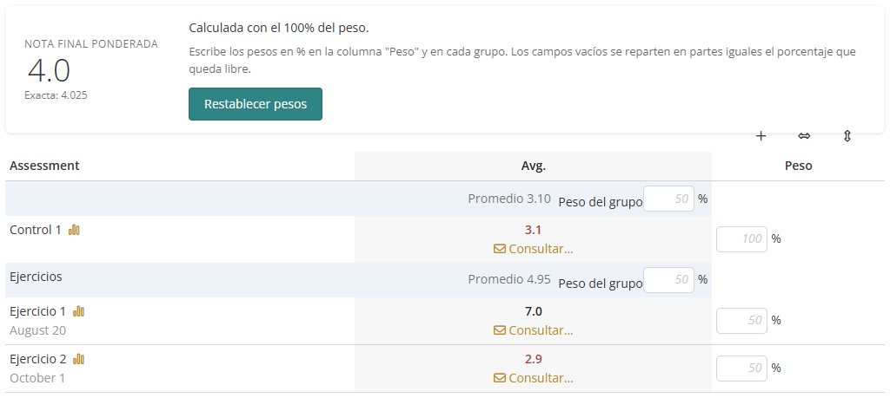

> Archivo: `easyCopyGrades.js`

- Copia rápidamente tus notas en formato horizontal (para hojas de cálculo), vertical o como una suma (para calculadoras como Wolfram Alpha).

#### Copia Fácil de Miembros
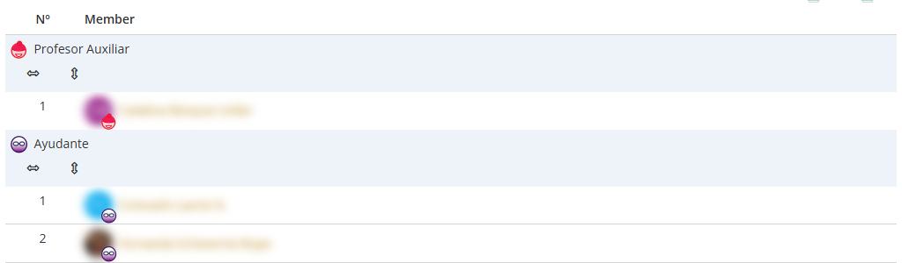

> Archivo: `easyCopyMembers.js`

- Agrega botones para copiar la lista de integrantes de un curso en formato horizontal o vertical, ideal para crear listas o informes.

#### Copia Fácil de Datos del Curso


> Archivo: `easyCopyCourseDetails.js`

- Añade un botón de copiado rápido junto al nombre y código del curso para pegarlos fácilmente donde necesites.

---

## ✨ Mejoras de Interfaz y Experiencia de Usuario

#### 🖌 Renombrar Cursos
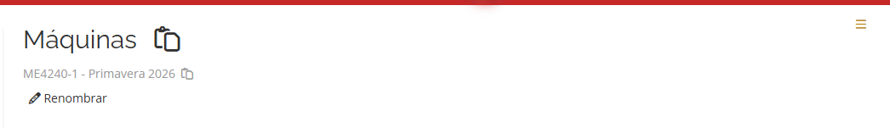

> Archivo: `renameCourses.js`

- ¿Nombres de cursos muy largos o poco descriptivos? Ahora puedes renombrarlos para una mejor organización. La extensión recordará tus nombres personalizados.

#### 🔍 Filtro Rápido en Navegación (Fuzzy Search)
> Archivos: `fuzzySearchHelper.js`, `fuzzySearch.js`

- **Búsqueda Difusa:** Se añade una barra de filtro de estilo nativo al final del contenedor del curso. Te permite escribir sin importar espacios o caracteres incompletos para buscar instantáneamente entre los elementos de navegación y las listas del historial o foros.

#### 💥 Secciones Colapsables
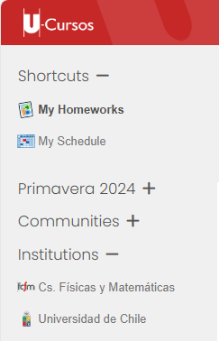

> Archivo: `collapsableMenus.js`

- Organiza tu página de inicio colapsando las secciones que no necesitas ver. La extensión guarda el estado (abierto/cerrado) de cada sección.
- **Efecto Dock de macOS:** Los elementos dentro de cada sección exhiben un efecto de magnificación al estilo del Dock de macOS al pasar el cursor.

#### 🔄 Autocarga de Páginas (Infinite Scroll)
> Archivo: `autoPreload.js`

- **Infinite Scroll:** Detecta mediante un `IntersectionObserver` cuándo te aproximas al final del historial de un curso o un foro. Carga de manera asíncrona (1 por 1) las siguientes páginas, previniendo duplicaciones o sobrecargas y respetando la codificación nativa (UTF-8/ISO-8859-1) para tildes y eñes. Los nuevos elementos se incorporan en tiempo real al Filtro Rápido.

#### 💬 Interacción con Foros
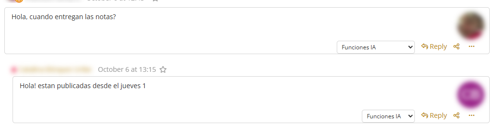

> Archivo: `forumInteraction.js`

- **Funciones IA:** Un menú desplegable nativo junto a "Reply" y "Permalink" permite copiar un post o el hilo completo, o enviarlo a Claude, ChatGPT, Gemini o Perplexity para resumirlo o analizarlo.

#### 🧮 Ponderador de Notas
> Archivo: `gradesWeights.js`

- Agrega una columna **Peso** a la tabla de notas y un campo **Peso del grupo** en cada grupo de evaluaciones (Casos prácticos, Tareas, Test...).
- Muestra arriba de la tabla tu **nota final ponderada**, calculada como $\sum_j W_j \sum_i w_{ij}\, g_i$, donde $W_j$ es el peso del grupo $j$ y $w_{ij}$ el peso de la evaluación $i$ dentro de ese grupo.
- Los campos vacíos se reparten en partes iguales el porcentaje que queda libre, así que funciona sin configurar nada. El grupo "Notas para el Acta" parte en 0% para no contar dos veces la nota oficial.
- Si aún faltan notas, indica qué porcentaje del peso llevas evaluado y tu promedio sobre lo evaluado. Avisa cuando los pesos no suman 100%.
- Los pesos se guardan por curso.

#### 📖 Recortar Texto Largo ("Mucho Texto")
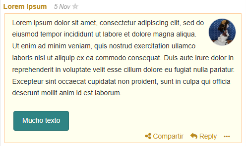

> Archivo: `muchoTexto.js`

- Oculta automáticamente los posts de foros que son muy largos detrás de un botón "Mucho Texto", manteniendo la interfaz más limpia y legible.

#### 📐 Redimensionar Vista Previa de PDF
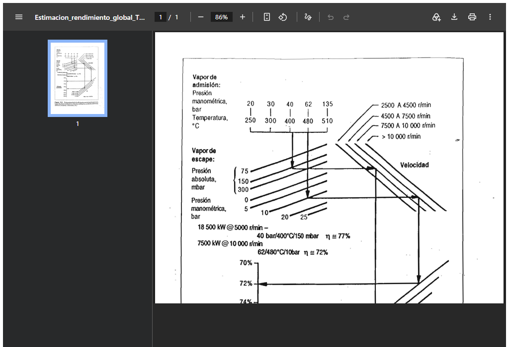

> Archivo: `resizePreviewPDF.js`

- Permite ajustar verticalmente el tamaño del visor de PDF, ideal para aprovechar mejor el espacio en pantallas verticales.

#### 🔊 Sonido de Entrega de Tareas
> Archivo: `taskSubmissionSound.js`

- Recibe una gratificante confirmación sonora cada vez que interactúas con la sección de tareas.
- Ahora activo en todas las páginas de tareas (not solo en el detalle de entrega).
- El audio se reproduce mediante un iframe de YouTube embebido.

#### ✍️ Autocompletar Tareas
> Archivo: `tareaPrefill.js`

- Rellena automáticamente el tiempo invertido y un comentario base al abrir el formulario de entrega de una tarea.
  - Se usa " $(\Delta \text{Días}) \cdot (60 \, \text{min/día}) \cdot [\text{random}(0.8, 1.2)]$ " para el tiempo invertido.
  - Se usa el formato "Se hace entrega de <título de la tarea>".
- Solo actúa en la vista de detalle de tareas y respeta lo que el usuario ya haya escrito.
- Se puede activar o desactivar desde el menú de configuración de la extensión.

#### ✨ Animaciones de Navegación


> Archivo: `navigationAnimations.js`

- Añade un efecto de magnificación al estilo del Dock de macOS al menú de navegación principal: los ítems se escalan suavemente al pasar el cursor, dando una experiencia más fluida y moderna.

#### 🌓 Tema según el Sistema
> Archivo: `systemTheme.js`

- Reemplaza la lista de temas del pie de página de U-Cursos por un menú desplegable que agrega **Focus (Sistema)** y **Clásico (Sistema)** a los cuatro temas nativos.
- Detecta la preferencia de tu sistema operativo (`prefers-color-scheme`) y aplica automáticamente la variante clara u oscura del tema elegido (`focus` / `focus-dark` o `classic` / `classic-dark`).
- Reacciona en vivo: si tu sistema cambia de claro a oscuro (o viceversa), el tema de U-Cursos se actualiza solo.
- Elegir manualmente cualquier tema nativo (Focus, Focus Oscuro, Claro, Oscuro) desactiva el modo automático.
- Se puede activar o desactivar desde el menú de configuración de la extensión.

---

## 🔔 Notificaciones y Atajos

#### Notificación de Tareas y Pendientes
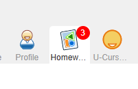 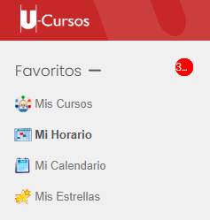

> Archivos: `pendingTasks.js`, `pendingNotifications.js`

- Muestra insignias con el número de tareas pendientes y notificaciones no leídas directamente en el menú de navegación y en las secciones de la página principal.

#### 📆 Contador de Semanas Inteligente


> Archivo: `weekCounter.js`

- **Precisión Multi-vista:** Muestra el número de la semana lectiva actual en las 4 pestañas de horario (Agenda, Día, Semana y Mes) extrayendo la fecha de manera segura. Resuelve errores para usuarios con días libres o clases en fines de semana mediante un escaneo exhaustivo de la cuadrícula, y persiste localmente la información por semestre para cargas instantáneas.

#### 🔘 Otras Realizaciones del Curso
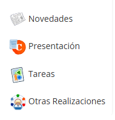

> Archivo: `otrasRealizaciones.js`

- Agrega un atajo en el menú de cada curso para acceder rápidamente a la página de "Otras Realizaciones".

#### ✔ Ventana Emergente de Calificaciones
> Archivo: `popupGrading.js`

- Abre el historial de calificaciones en una ventana emergente en lugar de redirigirte a otra página.

---

## 🏆 Sistema de Logros
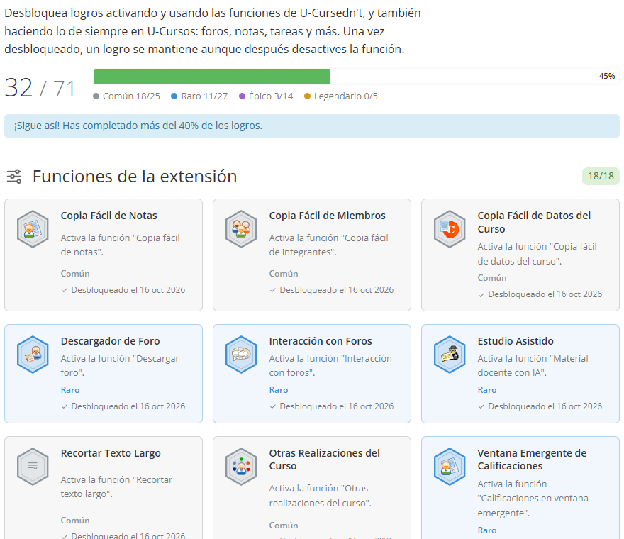

> Archivos: `achievementsGen.js`, `achievementsBoton.js`, `achievementToast.js`, `ucursosActivity.js`, `catalog.js`, `extensionPages.js`

- **Gamificación:** 71 logros en tres familias: 18 por activar funciones de la extensión, 14 por interactuar con ellas y 39 por hacer lo de siempre en U-Cursos.
- **Logros de U-Cursos:** `ucursosActivity.js` detecta acciones típicas de un estudiante de la U. de Chile, agrupadas en cuatro categorías:
  - **Foros:** entrar al foro de un curso o de la facultad, publicar tu primer mensaje (y 10 más), abrir un hilo con 10 o más respuestas, leer un hilo de compraventa ("Vendo mi TI-Nspire") o uno preguntando por las notas.
  - **Ramos, notas y tareas:** revisar las notas 5 veces el mismo día ("F5 a las Notas"), entregar una tarea (o entregarla entre las 23:00 y las 23:59), abrir Mis Tareas sin pendientes, descargar 10 archivos de material, responder una encuesta, revisar asistencias, historial o Clase Virtual.
  - **Comunidad y perfil:** marcar estrellas, reaccionar, agregar Favoritos o una página de inicio, votar, subir un afiche, enviar un correo, visitar 3 comunidades o el perfil de otra persona.
  - **Hábitos y exploración:** temas oscuros, U-Cursos en inglés, el buscador, cursos de hace 5 años o más, la página 50 de un listado, 12 módulos distintos, trasnoches, fines de semana, Fiestas Patrias y rachas de 7 y 30 días.
- **Privacidad:** Todo se calcula en tu navegador con contadores guardados en el almacenamiento de la extensión (`ucursosActivity`); no se envía nada a ningún servidor.
- **Página de Logros:** Accede a una página dedicada desde el menú principal para ver tu progreso, el total de logros y los que te faltan por descubrir, como medallas por rareza (común, raro, épico, legendario).
- **Logros permanentes:** Cada logro se guarda con su fecha de desbloqueo y se mantiene aunque después desactives la función que lo otorgó.
- **Notificaciones:** Al desbloquear un logro aparece un aviso en la esquina inferior derecha, al estilo de Steam, con la medalla y su rareza.
- **Estilo nativo:** La página usa los componentes de U-Cursos y sigue el tema activo, claro u oscuro.

---

## 🗺️ Guía de Usuario (Tour Guide)
- **Modo Silencioso:** Centraliza las alertas informativas de primeros pasos (onboarding) mediante un interceptor global que evalúa las preferencias del usuario antes de desplegar popups invasivos.

---

## ⚙️ Menú de Configuración
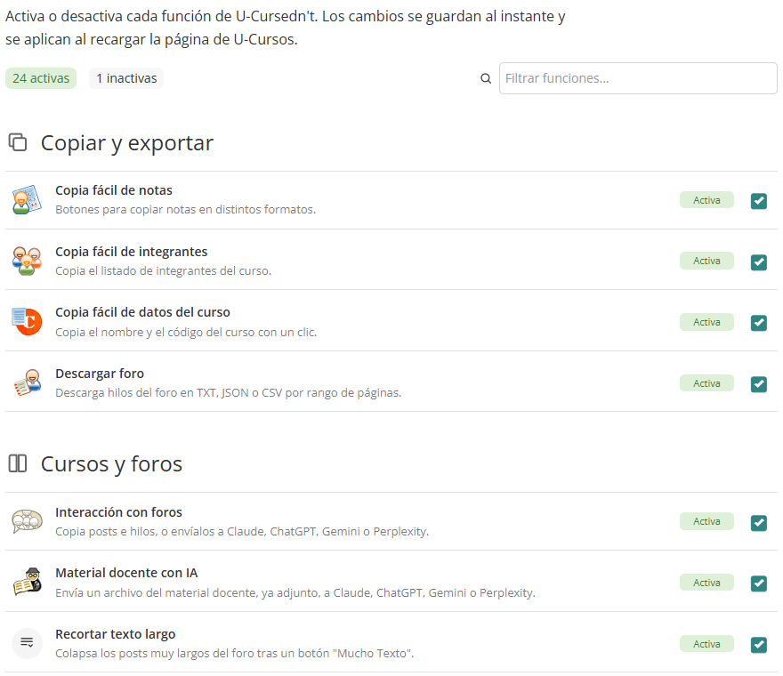

> Archivos: `menuGen.js`, `menuBoton.js`, `extensionPages.js`

- **Control Total:** Activa o desactiva cualquier funcionalidad de la extensión desde un menú agrupado por categoría, con filtro de búsqueda y el estilo nativo de U-Cursos (sigue el tema claro u oscuro).
- **Gestión de Datos:** Visualiza y gestiona los datos que la extensión guarda en tu navegador.

---

# Instalación Local

## Chrome

> Tutorial en [video](https://www.youtube.com/watch?v=oswjtLwCUqg) (24s).

1. Clonar el repositorio desde GitHub.
2. Ejecutar la pipeline mediante el script automatizado para empaquetar los archivos fuentes:
   ```bash
   python scripts/build.py

```

3. Abrir Chrome y navegar a `chrome://extensions/`.
4. Habilitar el modo desarrollador (Developer Mode) en la esquina superior derecha de la página.
5. Click en "Load unpacked" (Cargar extensión sin empaquetar), luego seleccionar la carpeta generada **`dist/chrome/`**.

## Firefox

1. Clonar el repositorio desde GitHub.
2. Ejecutar el script automatizado para estructurar el compilado de Gecko:
```bash
python scripts/build.py

```


3. Abrir Firefox y navegar a `about:debugging#/runtime/this-firefox`.
4. Click en "Load Temporary Add-on..." (Cargar complemento temporal).
5. Seleccionar el archivo **`dist/firefox/manifest.json`** o directamente el paquete comprimido `.zip` generado en la raíz de `dist/`.

## Opera

1. Realizar los pasos de compilación con `python scripts/build.py`.
2. Abrir Opera y visitar `opera://extensions/`.
3. Activar Modo Desarrollador y cargar la carpeta descomprimida **`dist/chrome/`**.

## Microsoft Edge

1. Realizar los pasos de compilación con `python scripts/build.py`.
2. Abrir Microsoft Edge y navegar a `edge://extensions/`.
3. Activar Modo Desarrollador y cargar la carpeta descomprimida **`dist/chrome/`**.

---

## Verificar selectores de U-Cursos

`scripts/crawl_ucursos.py` recorre tus cursos, comunidades y módulos con tu sesión y genera un reporte con los formularios y selectores que usa `ucursosActivity.js`. Solo hace peticiones GET y nunca sigue enlaces con `csrf`, `accion`, `subaccion` o `logout`, así que no publica, no vota ni cierra tu sesión.

```bash
pip install requests beautifulsoup4
python scripts/crawl_ucursos.py                                          # cookies del perfil de Zen Browser
python scripts/crawl_ucursos.py --cookies scripts/logs/ucursos_cookies.json  # export JSON de cookies
```

El HTML de cada página y `report.md` quedan en `scripts/logs/ucursos_crawl_<fecha>/`. Guarda el archivo de cookies dentro de `scripts/logs/`, que está ignorado por git: esas cookies dan acceso a tu cuenta.

---

> **Nota sobre el versionado:** U-Cursedn't usa un esquema de versión basado en fecha: **`AA.MM.V`**, donde `AA` es el año (dos dígitos), `MM` el mes, y `V` el número de versión dentro del mes Por ejemplo, `26.6.1` corresponde a la primera versión de junio de 2026.

> **Integración Continua y Validación:** Cada versión pasa por un proceso de linting estático pre-build integrado en Python que valida la sanidad de los JSONs, previene el uso inseguro de `innerHTML` y busca tokens de sintaxis rotos (como comas consecutivas). Conserva un historial histórico rotativo de hasta 3 versiones empaquetadas en la carpeta `/archive`.
